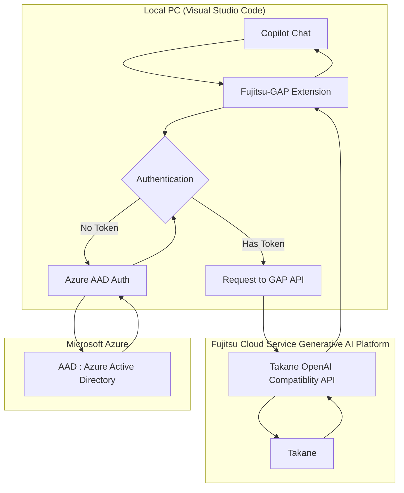

# Fujitsu-GAP Copilot Custom Model 拡張機能

この拡張機能は、GitHub Copilot Chat のカスタムモデルとして「Fujitsu Cloud Service Generative AI Platform (Fujitsu-GAP)」へ接続するための VS Code 拡張機能です。

## 概要

本拡張機能をインストールすることで、VS Code の設定画面から `Tenant Name` と `Client ID` を設定するだけで、Fujitsu-GAP のカスタムモデルを Copilot Chat で利用できるようになります。

従来のように `settings.json` に複雑なエンドポイント設定や API キーを直接記述する必要はありません。認証は Azure AD B2C の対話認証（ブラウザ連携）を利用して安全に行われます。

## 動作フロー

本拡張機能を利用した際の処理の流れは以下の通りです。

## 事前準備

本拡張機能を利用するために、以下の準備を行ってください。

1. **Azure AD 認証へのアクセス権**

* 認証に必要な「Tenant Name」および「Client ID」が発行されていることを確認してください。

## インストール方法

1. **VSIX ファイルの入手**

* 配布された `.vsix` ファイルを用意します。

2. **VS Code へのインストール**

* VS Code を起動します。
* サイドバーの「拡張機能」ビュー (Ctrl+Shift+X) を開きます。
* 右上の「...」 (その他のアクション) メニューをクリックし、**「VSIX からインストール... (Install from VSIX...)」** を選択します。
* `.vsix` ファイルを選択してインストールします。

## 設定方法

インストール後、以下の手順で接続情報を設定してください。

1. **設定画面を開く**

* `Ctrl + ,` (カンマ) を押して設定画面を開きます。
* 検索窓に **「Fujitsu-GAP」** と入力します。

2. **接続情報の入力**

* **Tenant Name**: ご利用のテナント名を入力してください。
* **Client ID**: 発行された Client ID を入力してください。
* **Max Input Token**: 128K (131072) を入力してください。

## 利用方法

1. **Copilot Chat を起動**

* `Ctrl + Shift + I` またはチャットパネルを開きます。

2. **モデルの選択**

* モデル選択メニューから **「Fujitsu-GAP」** グループ内の **「Fujitsu Cloud Service Generative AI Platform Custom Model」** を選択します。

3. **認証の実行（ブラウザ認証）**

* 初回利用時、またはトークン期限切れ時に、自動的にブラウザが起動します。
* ブラウザのサインイン画面で、ご自身の **ID とパスワード** を入力して認証を行ってください。
* 認証が完了したらブラウザのタブを閉じ、VS Code に戻ります。

## 動作確認・モデル切り替えの確認方法

正しく Fujitsu-GAP のカスタムモデルに切り替わり、接続できているかを確認するには以下の方法を行います。

1. **チャットパネルでの選択状態の確認**
* GitHub Copilot Chat の入力欄付近にあるモデル選択ドロップダウンを開き、「Fujitsu-GAP」のカスタムモデルがアクティブ（選択状態）になっていることを確認します。

2. **テストプロンプトの送信**
* チャット上で簡単なメッセージ（例: `こんにちは` や `自己紹介をして` など）を送信します。
* 初回の場合はブラウザでの認証画面が立ち上がるため、サインインを完了させます。

3. **出力ログ（Output Channel）の確認**
* VS Code のメニューから **「表示」 > 「出力」 (View > Output)** を選択します。
* 上部のドロップダウンメニューから **「Fujitsu-GAP」**（または本拡張機能に関連する出力チャネル）を選択します。
* 認証トークンの取得成功ログや、Fujitsu-GAP API へのリクエスト・レスポンス（ステータスコード 200 OK など）が正しく出力されていることを確認できます。
